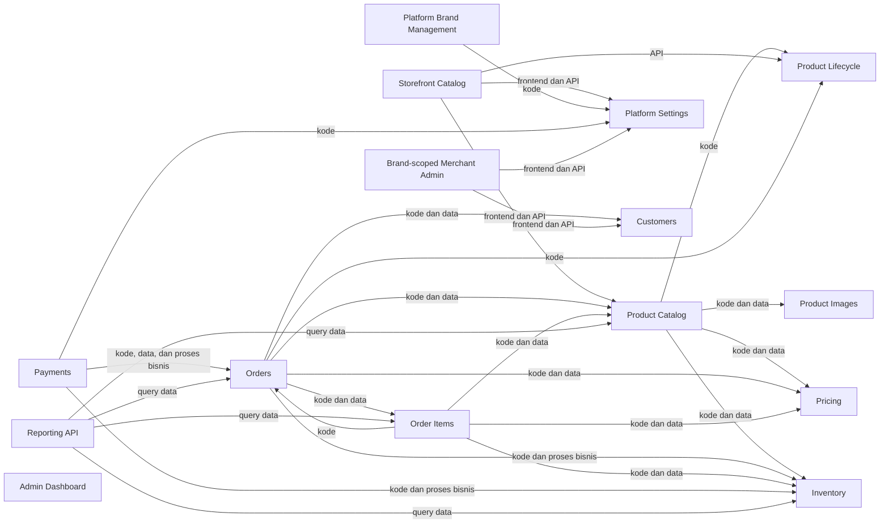

# CommerceMind Module Dependencies

## A. Architecture Summary

Frontend SvelteKit memanggil API backend melalui client pada `frontend/src/lib/api/` dan helper storefront di `frontend/src/lib/storefront/`. FastAPI mendaftarkan router di `backend/main.py`; handler pada `backend/api/` memvalidasi request dan memanggil CRUD/domain logic di `backend/crud/`. Layer tersebut membaca atau mengubah SQLAlchemy model di `backend/models/`, sementara `backend/schema_models/` membentuk kontrak request/response.

Hubungan di dokumen ini dibuktikan lewat pemanggilan kode dan/atau struktur model. Peta ini bukan hasil pengujian runtime. Panah diagram berarti “modul di kiri menggunakan atau bergantung pada modul di kanan”.

## B. Inter-module Dependency Map

### Confirmed Relationships

- **Product Catalog → Product Lifecycle** — **jenis: kode.** Pembentukan availability membaca status produk dan menghasilkan `is_purchasable` serta alasan unavailable. Bukti: `build_product_availability` dan `_not_purchasable_reason` di `backend/crud/products.py`.
- **Product Catalog → Product Images** — **jenis: kode dan data.** Availability memilih gambar utama/fallback; detail storefront memuat seluruh gambar produk. Bukti: `build_product_availability` dan `build_product_storefront_detail` di `backend/crud/products.py`; relasi `Product.images` di `backend/models/catalog.py`.
- **Product Catalog → Inventory** — **jenis: kode dan data.** Availability membaca `InventoryItem` untuk stok fisik, reserved, available, dan low-stock. Bukti: `build_product_availability` di `backend/crud/products.py`.
- **Antarmuka Product Catalog ↔ Inventory** — **jenis: frontend/API.** Detail produk admin meminta availability, movements, dan active reservations melalui `productsApi` serta `inventoryApi`; halaman inventory meminta daftar produk bersama daftar inventory. Bukti: `frontend/src/routes/admin/products/+page.svelte`, `frontend/src/routes/admin/inventory/+page.svelte`, `frontend/src/lib/api/products.ts`, `frontend/src/lib/api/inventory.ts`.
- **Product Catalog → Pricing** — **jenis: kode dan data.** Harga efektif membaca `PriceSet` dan `PriceSetItem` aktif, lalu fallback ke `Product.base_price`. Bukti: `_get_effective_price` di `backend/crud/products.py`.
- **Storefront Catalog → Product Catalog/Product Lifecycle** — **jenis: frontend, API, dan kode.** Halaman storefront mengambil katalog dan detail produk; backend hanya mengembalikan katalog publik sesuai flag dan detail produk dengan status aktif. Bukti: `frontend/src/lib/storefront/products.ts`, halaman `frontend/src/routes/storefront/` dan `frontend/src/routes/brands/[brandSlug]/`; `backend/api/products.py`, `backend/crud/products.py`.
- **Storefront Catalog → Platform Settings** — **jenis: frontend/API dan kode.** Storefront brand-scoped meminta public config untuk memperoleh `brand_id` dan flag tampilan; API katalog juga membaca settings untuk memeriksa `public_catalog_enabled` dan `products_enabled`. Bukti: `getPublicStorefrontConfig` di `frontend/src/lib/api/storefront-config.ts`, `backend/api/settings.py`, `backend/api/products.py`.
- **Platform Brand Management → Platform Settings** — **jenis: kode dan data.** Pembuatan brand memanggil `ensure_platform_settings` untuk menyiapkan row setting per brand dan mencatat audit log. Bukti: `create_brand` dan `ensure_platform_settings` di `backend/crud/settings.py`.
- **Payments → Platform Settings** — **jenis: kode.** Handler payment membaca konfigurasi brand dan menolak operasi tertentu jika `payments_enabled` false. Bukti: `_require_payments_enabled` di `backend/api/payments.py`.
- **Orders → Customers** — **jenis: kode dan data.** API create order mencari customer dalam brand pada payload sebelum memanggil CRUD; model order memiliki FK ke customer. Bukti: `create_order` di `backend/api/orders.py`, `backend/models/orders.py`.
- **Orders → Product Catalog/Product Lifecycle/Pricing/Inventory** — **jenis: kode, data, dan proses bisnis.** Pembentukan order item mencari produk per brand, mendapatkan quote harga, membangun availability, memeriksa status/stok/harga, membuat snapshot item, kemudian mereservasi stok untuk order. Bukti: `create_order`, `_build_order_item`, `_get_order_price_quote` di `backend/crud/orders.py`; `reserve_stock_for_order` di `backend/crud/inventory_service.py`.
- **Order Items → Product Catalog/Pricing/Inventory** — **jenis: kode dan data.** Endpoint create item memeriksa produk, lalu CRUD item memakai `build_order_item_for_order`; helper tersebut mencari produk, menghitung quote harga, dan membangun availability yang membaca inventory. Bukti: `backend/api/order_items.py`, `backend/crud/order_items.py`, `backend/crud/orders.py`, `backend/crud/products.py`.
- **Order Items → Orders** — **jenis: kode.** CRUD order item mengimpor dan memanggil `build_order_item_for_order` dari modul orders. Bukti: `backend/crud/order_items.py`, `backend/crud/orders.py`.
- **Payments → Orders/Inventory** — **jenis: kode, data, dan proses bisnis.** Payment mengacu order; perubahan status paid memperbarui status order, sedangkan failed memanggil `release_stock_for_order` dan mengubah status order menjadi cancelled sesuai kondisi kode. Bukti: `_apply_payment_lifecycle` di `backend/crud/payments.py`; relasi model di `backend/models/payments.py` dan `backend/models/orders.py`.
- **Orders → Inventory saat cancel/fulfill** — **jenis: kode dan proses bisnis.** Cancel melepas reservation; fulfill meng-commit reservation. Bukti: `cancel_order` dan `fulfill_order` di `backend/crud/orders.py`, yang memanggil `release_stock_for_order` dan `commit_stock_for_order`.
- **Reporting API → Product Catalog/Order Items/Orders/Inventory** — **jenis: query data.** Query revenue menggabungkan `Product`, `OrderItem`, dan `Order`; laporan stok menggabungkan `Product` dengan `InventoryItem`. Bukti: fungsi query di `backend/crud/reports.py`.
- **Brand-scoped Merchant Admin → Platform Settings/Customers** — **jenis: frontend dan API.** Halaman customer memuat public config berdasarkan slug untuk mendapatkan brand ID, lalu mengambil customer summary/detail dan melakukan update melalui customer API. Bukti: `frontend/src/routes/brands/[brandSlug]/admin/customers/+page.svelte`, `frontend/src/lib/api/customers.ts`, `frontend/src/lib/api/storefront-config.ts`.

### Relationships Not Found as Direct Dependencies

- **Admin Dashboard** tidak memanggil API dalam halaman yang diperiksa; angka metric, order terbaru, dan stock alert dibuat dari konstanta lokal. Bukti: `frontend/src/routes/admin/+page.svelte`.
- Tidak ditemukan pemanggilan API Reporting dari Admin Dashboard atau halaman report frontend. Backend Reporting API ada, tetapi terpisah dari dashboard statis.
- Tidak ditemukan route/API cart atau checkout yang menghubungkan Storefront Catalog ke Orders. Adanya flag cart/checkout dan helper customer checkout bukan bukti integrasi proses pembelian.
- Pricing tidak memiliki route API atau UI pengelolaan tersendiri dalam area yang diperiksa. Hubungan Pricing → Product Catalog/Orders yang dicatat di atas adalah pembacaan data `PriceSet` saat menghitung harga, bukan integrasi endpoint pricing terpisah.

## C. Main Process Flows

### Product Management

1. Halaman admin menggunakan `productsApi` untuk list, create, update, delete, lifecycle action, serta membaca availability (`frontend/src/routes/admin/products/+page.svelte`, `frontend/src/lib/api/products.ts`).
2. Client memanggil `/products/*`; router di `backend/api/products.py` mendelegasikan operasi ke `backend/crud/products.py`.
3. CRUD mengubah atau membaca `Product`; pembuatan/update menerima `ProductCreate`/`ProductUpdate` dari `backend/schema_models/product.py`.
4. Availability membaca inventory, gambar, dan effective price, lalu menyusun schema `ProductAvailability`.

**Belum dikonfirmasi:** alur ini tidak diuji dalam task dependency mapping; tidak semua aksi frontend diverifikasi melalui browser.

### Inventory Management

1. Halaman inventory memanggil inventory list dan product list saat memuat data (`frontend/src/routes/admin/inventory/+page.svelte`).
2. API client `inventoryApi` memanggil `/inventory-items/*` (`frontend/src/lib/api/inventory.ts`).
3. Handler inventory memanggil CRUD sederhana atau `backend/crud/inventory_service.py` untuk receive, adjust, reserve, release, dan commit.
4. Domain service mengubah `InventoryItem`, membuat `InventoryReservation`, dan menambahkan `InventoryMovement`.
5. Product availability membaca inventory item yang sama untuk menghitung stok tersedia dan purchasability.

**Belum dikonfirmasi:** konsistensi transaksi dan perilaku runtime tidak diuji ulang.

### Brand-scoped Storefront Catalog

1. Route brand meminta `/storefront/{brand_slug}/config` melalui `getPublicStorefrontConfig`.
2. Config menyediakan `brand_id`, identitas storefront, dan flag publik.
3. Route katalog/detail mengirim `brand_id` ke `productsApi.catalog` atau `productsApi.getDetailBySlug` melalui `storefrontProductsApi`.
4. `backend/api/products.py` memeriksa settings untuk endpoint katalog publik, lalu CRUD menyusun data produk bersama image, inventory, dan harga efektif.

**Batas proses:** ini membuktikan jalur pembacaan katalog dalam kode, bukan jalur cart/checkout. Pemanggilan endpoint tidak dijalankan untuk task ini.

### Customer Management

1. Halaman `/brands/[brandSlug]/admin/customers` meminta config brand.
2. Halaman memakai `config.brand_id` untuk meminta summary/detail customer dan melakukan update customer/alamat melalui `customersApi`.
3. Handler `/customers/*` memanggil `backend/crud/customers.py`, yang mengakses `Customer` dan `CustomerAddress`.

**Batas proses:** halaman legacy `/admin/customers` redirect ke default brand; alur auth pengguna tidak menjadi bagian dari pemetaan ini.

### Order, Inventory, and Payment

1. `POST /orders/` memeriksa keberadaan customer per brand di `backend/api/orders.py`.
2. `create_order` membuat order dan memproses item satu per satu melalui `_build_order_item`.
3. `_build_order_item` memastikan produk cocok dengan brand, mendapatkan harga dari price set aktif atau base price, membangun availability, dan menolak produk nonaktif, stok kurang, atau harga tidak tersedia.
4. Order item menyimpan harga, subtotal, snapshot data produk, serta sumber harga.
5. Setelah order dan item di-flush, `reserve_stock_for_order` membuat reservation; order berstatus pending menjadi awaiting_payment sebelum commit.
6. `POST /payments/` memeriksa order dan flag payments, kemudian `create_payment` memanggil `_apply_payment_lifecycle`.
7. Status paid mengisi `paid_at` bila kosong dan dapat mengubah status order menjadi paid.
8. Status failed melepas reservation dan dapat mengubah order menjadi cancelled.
9. Fulfill order meng-commit reservation dan mengurangi stok fisik.

**Batas proses:** kode menghubungkan operasi tersebut, tetapi jalur pembayaran gateway, retry, dan keadaan runtime tidak diperiksa atau diuji. `refunded` pada `_apply_payment_lifecycle` tidak memanggil inventory service dalam kode yang diperiksa.

### Platform Settings and Brand

1. Console frontend menggunakan `platformSettingsApi` untuk daftar/buat/perbarui brand dan settings.
2. API `/platform/brands*` dan `/platform/settings*` memanggil `backend/crud/settings.py`.
3. Pembuatan brand membuat row pengaturan terkait melalui `ensure_platform_settings` dan mencatat audit log.
4. Pembacaan public storefront config menyusun data Brand, BrandSettings, StorefrontSettings, SeoSettings, ModuleSettings, dan SystemSettings menjadi schema publik.
5. Storefront dan beberapa API domain memakai config/flag tersebut untuk menentukan konteks brand atau akses fitur tertentu.

**Belum dikonfirmasi:** tidak ada operasi simpan atau pemeriksaan akses yang dijalankan untuk dokumen ini.

## D. Data Dependencies

> Relasi berikut berasal dari `ForeignKey` dan `relationship()` pada model. Relasi database tidak dengan sendirinya membuktikan bahwa suatu fungsi selalu memanggil modul terkait saat runtime.

- **Brand** menjadi parent melalui FK `brand_id` pada Product, InventoryItem, InventoryReservation, InventoryMovement, Customer, CustomerAddress, Order, OrderItem, Payment, Channel, Region, dan model settings. Bukti: `backend/models/catalog.py`, `inventory.py`, `customers.py`, `orders.py`, `payments.py`, `channels.py`, `regions.py`, `settings.py`.
- **Product → ProductImage** melalui `product_images.product_id` dan relasi `Product.images`/`ProductImage.product`. Product menghapus gambar terkait melalui cascade ORM. Bukti: `backend/models/catalog.py`.
- **Product → InventoryItem** melalui `inventory_items.product_id` yang unique dan relasi satu-ke-satu. Bukti: `backend/models/catalog.py`, `backend/models/inventory.py`.
- **Product → PriceSet → PriceSetItem** melalui FK dan relasi ORM. PriceSetItem dapat merujuk Channel dan Region. Bukti: `backend/models/catalog.py`, `backend/models/pricing.py`, `backend/models/channels.py`, `backend/models/regions.py`.
- **Customer → CustomerAddress** melalui `customer_addresses.customer_id` dan relasi customer/address dengan cascade delete-orphan. Bukti: `backend/models/customers.py`.
- **Customer → Order** melalui `orders.customer_id`; model customer memiliki relasi kumpulan order. Bukti: `backend/models/customers.py`, `backend/models/orders.py`.
- **Order → OrderItem** melalui `order_items.order_id`; model Order mengatur relasi item dengan cascade delete-orphan. Bukti: `backend/models/orders.py`.
- **OrderItem → Product** melalui `order_items.product_id`. Item juga menyimpan snapshot nama, SKU, slug, cost price, unit price, subtotal, dan price source; nilai snapshot bukan FK tambahan. Bukti: `backend/models/orders.py`.
- **Order → Payment** melalui `payments.order_id` yang unique dan relasi satu-ke-satu. Bukti: `backend/models/orders.py`, `backend/models/payments.py`.
- **InventoryReservation → Product/Order/OrderItem** melalui FK eksplisit dan relationship ORM. Bukti: `backend/models/inventory.py`.
- **InventoryMovement → Product** melalui FK. `reference_type` dan `reference_id` adalah kolom biasa, bukan FK polimorfik yang ditegakkan model. Bukti: `backend/models/inventory.py`.
- **Brand → Settings** melalui FK `brand_id` yang unique pada BrandSettings, StorefrontSettings, SeoSettings, ModuleSettings, dan SystemSettings; relasi Brand memakai one-to-one ORM. AuditLog memiliki FK brand opsional. Bukti: `backend/models/settings.py`.
- **Reporting** tidak memiliki model report tersendiri dalam area model yang diperiksa; query report membaca dan menggabungkan Product, OrderItem, Order, dan InventoryItem. Bukti: `backend/crud/reports.py`.

## E. Limitations and Incomplete Dependencies

- Admin Dashboard tidak terhubung dengan Reporting API pada halaman yang diperiksa; angka dashboard bersifat statis.
- Reporting API tersedia di backend, tetapi halaman report khusus tidak ditemukan di `frontend/src/routes/`.
- Orders dan Payments memiliki handler/domain backend, tetapi halaman admin terkait berupa placeholder.
- Brand-scoped admin memiliki halaman customer yang menggunakan brand config, sedangkan halaman product/inventory/order masih mengarah ke panel legacy default.
- Storefront terhubung ke public config dan product catalog, tetapi route/API cart dan checkout tidak ditemukan.
- Customer checkout helper ada, namun tidak ditemukan endpoint checkout yang memakainya sebagai alur publik.
- Price set dibaca oleh logika harga produk/order, tetapi route API/UI pengelolaan price set tidak ditemukan di area yang diperiksa.
- Tidak ditemukan integrasi payment gateway atau shipping execution pada alur yang diperiksa.

## F. Findings and Open Questions

- Perilaku transaksi lintas order, inventory, dan payment belum diverifikasi melalui tes atau runtime pada task ini.
- Perubahan status payment refunded tidak mengubah inventory pada helper yang diperiksa; dampak bisnis yang diharapkan tidak ditentukan oleh bukti kode ini.
- Model Channel dan Region serta price set tersedia, tetapi belum jelas bagaimana data channel/region dipilih saat menghitung effective price; query yang diperiksa mengurutkan price set item aktif berdasarkan priority/id tanpa filter channel/region.
- Order creation membaca harga efektif lewat query tersendiri di `backend/crud/orders.py`; kesamaan hasil dengan harga katalog belum diuji.
- Relasi inventory item memiliki `product_id` unique, sementara kolom `brand_id` juga tersimpan; konsistensi kedua brand ID belum diverifikasi sebagai constraint database.
- Beberapa endpoint menerima `brand_id`, sementara beberapa operasi domain mencari record hanya menggunakan ID. Dampak scoping lintas brand tidak diuji dalam task ini.
- Commit/perubahan data di database tidak dijalankan; dokumentasi hanya menjelaskan alur statis yang ditemukan.

## References

- Konteks discovery: `docs/discovery/existing-modules.md`, `docs/product/features-tree.md`
- Registrasi router: `backend/main.py`
- Frontend API clients: `frontend/src/lib/api/`
- Storefront clients: `frontend/src/lib/storefront/`
- Frontend pages: `frontend/src/routes/`
- API handlers: `backend/api/`
- CRUD/domain service: `backend/crud/`
- SQLAlchemy models: `backend/models/`
- Schemas: `backend/schema_models/`
