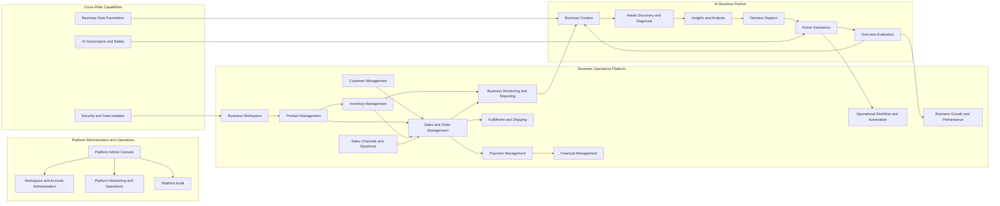

# CommerceMind — Target-State Product Capability Map

## 1. Document Purpose

Dokumen ini memetakan kapabilitas produk CommerceMind dalam target state: gambaran menyeluruh tentang hal yang berpotensi dapat disediakan produk ketika dikembangkan secara matang. Peta ini menjadi referensi untuk diskusi dan keputusan produk ke depan, bukan persetujuan untuk membangun seluruh kapabilitas yang tercantum.

Features Tree tidak dibatasi oleh kode, modul, schema, API, task sprint, atau fitur yang sudah disetujui. Repository menjadi bukti kondisi implementasi, sedangkan visi produk dan keputusan product owner menentukan arah scope. Setiap kapabilitas yang belum diputuskan tetap berstatus `Under Review`.

Dokumen mencakup feature yang bermakna bagi UMKM. Dokumen tidak dimaksudkan sebagai inventaris endpoint, tabel, CRUD, helper, maupun seluruh kemungkinan fitur enterprise.

## 2. Product Identity

- **Product Name:** CommerceMind
- **Product Vision:** Business Operations & Intelligence Partner for UMKM.
- **Product Positioning:** platform bisnis adaptif yang menggabungkan pengelolaan operasi bisnis dengan AI Business Partner.

Produk melayani dua kelompok pengguna: pengguna eksternal (Business Owners, Business Staff, dan End Customers) serta internal operator CommerceMind (Platform Owner, Platform Administrator, Customer Support, dan Technical Operator). Pengguna internal mengoperasikan platform melalui Platform Admin Console, bukan melalui Business Workspace; role internal merupakan model awal dan bukan permission matrix final.

CommerceMind membantu pemilik bisnis menjalankan dan mengelola usaha, memahami kondisinya, mengenali masalah dan peluang, mengeksplorasi solusi, mengambil keputusan berdasarkan informasi, serta menerapkan keputusan melalui kapabilitas operasional. Dalam proses tersebut, CommerceMind juga membantu pemilik mengembangkan kemampuan untuk memahami dan mengelola bisnisnya secara mandiri.

CommerceMind bukan sekadar accounting app, business dashboard, inventory system, ecommerce platform, chatbot, atau AI report generator. Produk mengintegrasikan kapabilitas operasional dengan business intelligence yang memahami konteks.

## 3. Product Vision

CommerceMind menjadi partner yang membantu UMKM memahami kebutuhan bisnisnya, bukan hanya menunggu instruksi atau pertanyaan. Platform Operations menyediakan catatan dan tindakan operasional; AI Business Partner menggunakan data yang relevan sebagai bukti untuk membantu pemilik menemukan kebutuhan, mendiagnosis kondisi, menimbang pilihan, dan belajar dari hasil keputusan.

Siklus kemampuan yang dituju:

```text
Understand Business
→ Identify Needs
→ Diagnose Problems
→ Explore Solutions
→ Support Decisions
→ Recommend Capabilities
→ Assist Implementation
→ Evaluate Outcomes
→ Adapt Recommendations
```

Siklus tersebut adalah model kapabilitas target, bukan klaim bahwa seluruh tahap sudah tersedia atau disetujui untuk dibangun.

## 4. Product Design Principles

### 4.1 Adaptive Business Platform

- Mendukung ragam model, ukuran, kompleksitas operasi, dan tingkat kematangan UMKM.
- Memungkinkan kapabilitas dipilih sesuai kebutuhan bisnis; pemilik tidak diwajibkan memakai semua kemampuan.
- Membedakan kapabilitas Core, Optional, dan Advanced.
- Menghindari kompleksitas yang tidak diperlukan usaha kecil.
- Mendukung pertumbuhan kapabilitas saat bisnis berkembang.
- Memungkinkan AI menyarankan kapabilitas yang relevan berdasarkan konteks, tanpa mengaktifkan atau menjalankannya diam-diam.

### 4.2 Business Understanding Before Recommendations

AI mempertimbangkan model bisnis, produk dan layanan, customer, proses operasional, kondisi keuangan, tujuan, batasan, dan kinerja historis yang relevan. AI tidak seharusnya memberi rekomendasi tanpa konteks yang memadai.

### 4.3 Need Discovery

CommerceMind berupaya membantu pemilik mengenali masalah operasional, isu kinerja, inefisiensi, peluang, serta kapabilitas yang mungkin belum tersedia. Sistem dapat mengajukan pertanyaan lanjutan dan membedakan gejala dari dugaan akar masalah.

### 4.4 Evidence-based Intelligence

Insight dan rekomendasi perlu merujuk data yang tersedia, menjelaskan alasan, mengungkap asumsi dan ketidakpastian, menunjukkan risiko serta trade-off, membedakan fakta dari hipotesis, dan mengakui bila data belum cukup.

### 4.5 Human-in-the-loop

Pemilik tetap memegang kewenangan keputusan. AI dapat menganalisis, menyarankan, menyiapkan, dan membantu tindakan; perubahan penting pada data atau operasi memerlukan otorisasi dan konfirmasi yang sesuai. Rekomendasi tidak boleh menjalankan tindakan berdampak secara diam-diam.

### 4.6 Continuous Business Development

CommerceMind mendukung peningkatan kemampuan pemilik dalam mengelola bisnis. Keberhasilan tidak hanya dilihat dari efisiensi operasi, tetapi juga dari meningkatnya pemahaman pemilik terhadap bisnisnya.

### 4.7 One Source of Business Truth

Business Operations Platform merupakan sumber utama data operasional. AI Partner menggunakan data tersebut sebagai evidence base dan tidak membuat salinan catatan bisnis yang saling bertentangan. Provenance dan konteks historis data perlu dipertahankan.

## 5. Product Architecture Overview

CommerceMind memiliki **tepat dua primary product pillars**: Business Operations Platform dan AI Business Partner. Platform Administration & Operations adalah capability group internal untuk mengoperasikan CommerceMind, bukan product pillar ketiga yang digunakan business customer. Cross-Pillar Capabilities adalah fondasi bersama, bukan product pillar.

```text
CommerceMind
├── Business Operations Platform
│   ├── Business Workspace & Configuration
│   ├── Business Users & Access Management
│   ├── Product Management
│   ├── Inventory Management
│   ├── Procurement & Supplier Management
│   ├── Customer Management
│   ├── Sales & Order Management
│   ├── Payment Management
│   ├── Financial Management
│   ├── Sales Channels & Storefront
│   ├── Fulfillment & Shipping
│   ├── Business Monitoring & Reporting
│   ├── Operational Workflow & Automation
│   └── Business Growth & Performance Management
├── AI Business Partner
│   ├── Business Context & Understanding
│   ├── Business Memory & History
│   ├── Conversational Business Assistant
│   ├── Business Needs Discovery
│   ├── Business Diagnosis
│   ├── Business Intelligence & Insights
│   ├── Business Analysis
│   ├── Root Cause Analysis
│   ├── Decision Support
│   ├── Scenario & What-if Analysis
│   ├── Business Planning & Strategy
│   ├── Business Guidance & Coaching
│   ├── Proactive Business Monitoring
│   ├── Business Opportunity Discovery
│   ├── AI Action & Workflow Assistance
│   ├── Decision and Outcome Evaluation
│   └── Continuous Business Adaptation
├── Platform Administration & Operations
│   ├── Platform Admin Console
│   ├── Internal Identity & Access Management
│   ├── Workspace and User Account Administration
│   ├── Subscription and Plan Administration
│   ├── Platform Configuration and Monitoring
│   ├── AI Operations
│   ├── Support and Incident Management
│   └── Audit and Data Maintenance
└── Cross-Pillar Capabilities
    ├── Business Data Foundation
    ├── Data Integration
    ├── External System Integration
    ├── Notification Infrastructure
    ├── Automation Infrastructure
    ├── Security & Privacy
    ├── Business Data Isolation
    ├── Auditability & Traceability
    ├── Reliability & Recovery
    └── AI Governance and Safety
```

### Actor Perspectives

Empat perspektif pengguna berikut membantu membaca tanggung jawab capability, tetapi tidak menambah product pillar:

| Actor Perspective | Capability Area |
|---|---|
| Administrator | Internal CommerceMind roles (Platform Owner, Platform Administrator, Customer Support, Technical Operator) menggunakan Platform Administration & Operations melalui Platform Admin Console. Akses mengikuti least privilege dan policy yang berlaku. |
| AI Business Partner | Menjalankan analisis, discovery, insight, decision support, action assistance, dan evaluasi di bawah pillar AI Business Partner. AI bukan pengambil keputusan bisnis. |
| Business Owner | Memiliki konteks dan keputusan bisnis; menggunakan Business Operations Platform serta dapat meminta dan meninjau bantuan AI. |
| Customer | Menggunakan capability customer-facing di Business Operations Platform, termasuk Storefront, Customer Account, Cart, Checkout, Order, Payment, dan Shipping/Tracking jika tersedia. |

### Feature ID Convention

Target-state Feature ID menggunakan prefix `CM-BO-XXX` untuk Business Operations Platform, `CM-AI-XXX` untuk AI Business Partner, `CM-PA-XXX` untuk Platform Administration & Operations, dan `CM-CP-XXX` untuk Cross-Pillar Capabilities. Nomor berurutan dalam masing-masing prefix. Subfeature menggunakan referensi hierarkis, misalnya `CM-BO-007.1`, dan bukan Feature ID mandiri.

Feature ID yang sudah ada pada Features Tree sebelumnya tetap dicatat verbatim sebagai **Legacy ID** dalam crosswalk pada bagian Feature Change Management. ID tersebut tidak digunakan ulang. ID target-state baru adalah ID kanonis pada peta ini; crosswalk menjaga keterlacakan tanpa menghilangkan keputusan atau status lama.

### How to Read the Feature Tree

Pohon di bagian 6–9 menunjukkan hirarki domain, feature, dan subfeature. Metadata table mencatat Parent Domain, tanggung jawab dan user value, Capability Type, relasi, Product Decision Status, Implementation Status, serta Legacy ID jika ada.

## 6. Business Operations Platform

Platform ini menyediakan kapabilitas adaptif untuk menjalankan usaha. Domain dapat digunakan sesuai model dan kebutuhan bisnis; tidak semua bisnis harus mengaktifkan semuanya.

### 6.1 Business Operations Feature Tree

- **Business Workspace & Configuration**
  - `CM-BO-001` Business Workspace & Brand Management
    - `CM-BO-001.1` Membuat dan mengelola workspace usaha.
    - `CM-BO-001.2` Mengatur identitas dan konteks workspace.
  - `CM-BO-002` Business Profile & Operating Context
    - `CM-BO-002.1` Mencatat model dan karakteristik bisnis.
    - `CM-BO-002.2` Mencatat tujuan, batasan, dan tahap perkembangan.
  - `CM-BO-003` Business Settings & Capability Configuration
    - `CM-BO-003.1` Mengatur preferensi operasional dan storefront.
    - `CM-BO-003.2` Memilih kapabilitas yang relevan untuk workspace.
  - `CM-BO-004` Brand-scoped Business Workspace
    - `CM-BO-004.1` Menjaga konteks workspace saat berpindah area kerja.
    - `CM-BO-004.2` Menyediakan akses operasional sesuai business context.
- **Business Users & Access Management**
  - `CM-BO-005` Business User & Team Management
    - `CM-BO-005.1` Mengundang, memperbarui, dan menonaktifkan anggota tim.
    - `CM-BO-005.2` Mengaitkan anggota dengan workspace atau tanggung jawab.
  - `CM-BO-006` Roles & Access Management
    - `CM-BO-006.1` Mengatur role dan cakupan akses.
    - `CM-BO-006.2` Membatasi tindakan berdasarkan otorisasi.
- **Product Management**
  - `CM-BO-007` Product & Service Catalog
    - `CM-BO-007.1` Mengelola informasi barang dan layanan.
    - `CM-BO-007.2` Mengelola variasi, identifier, dan pengelompokan yang relevan.
  - `CM-BO-008` Product Lifecycle Management
    - `CM-BO-008.1` Mengelola status ketersediaan dan lifecycle.
    - `CM-BO-008.2` Mempertahankan referensi produk pada riwayat transaksi.
  - `CM-BO-009` Product Media Management
    - `CM-BO-009.1` Mengelola gambar dan media produk.
    - `CM-BO-009.2` Menentukan media utama dan informasi aksesibilitas.
  - `CM-BO-010` Pricing Management
    - `CM-BO-010.1` Mengelola base price, biaya, dan harga jual.
    - `CM-BO-010.2` Mengelola aturan harga menurut konteks yang berlaku.
- **Inventory Management**
  - `CM-BO-011` Inventory Control
    - `CM-BO-011.1` Melihat on-hand, reserved, dan available quantity.
    - `CM-BO-011.2` Mencatat penerimaan, penyesuaian, reservation, dan stock movement.
  - `CM-BO-012` Stock Planning & Counting
    - `CM-BO-012.1` Melakukan stock count dan mencatat selisih.
    - `CM-BO-012.2` Menentukan threshold dan kebutuhan replenishment.
- **Procurement & Supplier Management**
  - `CM-BO-013` Supplier Management
    - `CM-BO-013.1` Mengelola kontak dan informasi supplier.
    - `CM-BO-013.2` Menyimpan terms dan riwayat hubungan supplier.
  - `CM-BO-014` Procurement & Receiving
    - `CM-BO-014.1` Menyiapkan dan melacak purchase order.
    - `CM-BO-014.2` Menerima barang serta membandingkan jumlah dengan pesanan.
- **Customer Management**
  - `CM-BO-015` Customer Records
    - `CM-BO-015.1` Mengelola profil, kontak, alamat, dan riwayat transaksi.
    - `CM-BO-015.2` Mencari dan mengelompokkan customer untuk kebutuhan layanan.
  - `CM-BO-016` Customer Relationships & Segmentation
    - `CM-BO-016.1` Memahami pola hubungan dan interaksi customer.
    - `CM-BO-016.2` Membentuk segmentasi sesuai kebutuhan bisnis.
  - `CM-BO-017` Customer Account & Self-Service
    - `CM-BO-017.1` Memberi customer akses ke profil dan alamatnya.
    - `CM-BO-017.2` Menampilkan riwayat order dan status yang relevan.
- **Sales & Order Management**
  - `CM-BO-018` Sales Order Management
    - `CM-BO-018.1` Mencatat dan mengelola order dari berbagai sumber.
    - `CM-BO-018.2` Mengelola lifecycle order, perubahan, dan pembatalan.
  - `CM-BO-019` Order Item Management
    - `CM-BO-019.1` Mengelola item, kuantitas, harga, dan subtotal.
    - `CM-BO-019.2` Mempertahankan snapshot informasi saat transaksi dibuat.
  - `CM-BO-020` Cart Management
    - `CM-BO-020.1` Menambah, mengubah, dan menghapus item cart.
    - `CM-BO-020.2` Mempertahankan cart sebelum order dikonfirmasi.
  - `CM-BO-021` Checkout & Order Capture
    - `CM-BO-021.1` Mengumpulkan customer, alamat, item, dan pilihan pembayaran.
    - `CM-BO-021.2` Mengonfirmasi rincian dan membuat order.
  - `CM-BO-022` Sales Channel Order Intake
    - `CM-BO-022.1` Menerima atau mencatat order dari channel yang terhubung.
    - `CM-BO-022.2` Meninjau data order sebelum diproses.
- **Payment Management**
  - `CM-BO-023` Payment Records & Lifecycle
    - `CM-BO-023.1` Mencatat payment dan statusnya terhadap order.
    - `CM-BO-023.2` Mencatat konfirmasi, kegagalan, dan refund.
  - `CM-BO-024` Payment Methods & Integrations
    - `CM-BO-024.1` Mengatur metode pembayaran yang didukung bisnis.
    - `CM-BO-024.2` Menghubungkan dan memantau payment provider bila diperlukan.
- **Financial Management**
  - `CM-BO-025` Financial Transactions & Expense Records
    - `CM-BO-025.1` Mencatat pemasukan, biaya, dan pengeluaran operasional.
    - `CM-BO-025.2` Menghubungkan catatan ke transaksi bisnis terkait.
  - `CM-BO-026` Cash Flow & Financial Performance
    - `CM-BO-026.1` Memahami arus kas dan kewajiban yang tercatat.
    - `CM-BO-026.2` Meninjau margin dan ringkasan kinerja keuangan.
- **Sales Channels & Storefront**
  - `CM-BO-027` Storefront Catalog & Experience
    - `CM-BO-027.1` Menampilkan katalog, harga, ketersediaan, dan detail produk.
    - `CM-BO-027.2` Mengatur identitas serta konten storefront.
  - `CM-BO-028` Sales Channel Management
    - `CM-BO-028.1` Mengatur channel penjualan dan pemetaan katalog.
    - `CM-BO-028.2` Memantau status sinkronisasi channel.
  - `CM-BO-029` Promotions & Merchandising
    - `CM-BO-029.1` Mengatur promotion, discount, atau bundle sederhana.
    - `CM-BO-029.2` Menyajikan produk sesuai campaign dan konteks channel.
- **Fulfillment & Shipping**
  - `CM-BO-030` Fulfillment Management
    - `CM-BO-030.1` Menyiapkan dan menyelesaikan pemenuhan order.
    - `CM-BO-030.2` Menghubungkan fulfillment dengan inventory dan order status.
  - `CM-BO-031` Shipping, Delivery & Tracking
    - `CM-BO-031.1` Mengatur informasi delivery dan shipment.
    - `CM-BO-031.2` Menyediakan status pengiriman dan tracking yang tersedia.
- **Business Monitoring & Reporting**
  - `CM-BO-032` Business Dashboard & KPIs
    - `CM-BO-032.1` Merangkum indikator operasi yang bersumber dari data.
    - `CM-BO-032.2` Menyediakan ringkasan sesuai peran dan kebutuhan.
  - `CM-BO-033` Business Reporting
    - `CM-BO-033.1` Menyajikan laporan penjualan, produk, dan inventory.
    - `CM-BO-033.2` Mendukung rentang waktu dan konteks bisnis yang jelas.
  - `CM-BO-034` Operational Alerts & Monitoring
    - `CM-BO-034.1` Menandai kondisi yang melewati threshold atau perlu ditinjau.
    - `CM-BO-034.2` Menautkan alert ke data dan tindakan tindak lanjut.
- **Operational Workflow & Automation**
  - `CM-BO-035` Operational Tasks & Workflows
    - `CM-BO-035.1` Membuat dan menugaskan task operasional.
    - `CM-BO-035.2` Melacak status, pemilik, dan penyelesaian workflow.
  - `CM-BO-036` Business Process Automation
    - `CM-BO-036.1` Menjalankan aturan sederhana berdasarkan kondisi bisnis.
    - `CM-BO-036.2` Meminta persetujuan sebelum tindakan berdampak.
- **Business Growth & Performance Management**
  - `CM-BO-037` Business Goals & Targets
    - `CM-BO-037.1` Mencatat tujuan dan target yang dipilih pemilik.
    - `CM-BO-037.2` Menghubungkan target dengan indikator yang relevan.
  - `CM-BO-038` Business Improvement Planning & Review
    - `CM-BO-038.1` Menyusun langkah perbaikan dan penanggung jawab.
    - `CM-BO-038.2` Meninjau kemajuan dan hasil terhadap tujuan.

### 6.2 Business Operations Feature Metadata

Seluruh feature target-state di bawah ini berstatus keputusan `Under Review`. Status implementasi merujuk bukti Discovery yang tersedia; `Unknown` berarti kapabilitas tersebut belum dipetakan cukup rinci, bukan pernyataan bahwa implementasinya pasti tidak ada.

| Feature ID | Feature Name | Parent Domain | Description | User Value | Capability Type | Related Features | Decision | Implementation | Legacy ID |
|---|---|---|---|---|---|---|---|---|---|
| CM-BO-001 | Business Workspace & Brand Management | Business Workspace & Configuration | Membuat dan mengelola ruang kerja bisnis beserta identitas brand. | Pemilik memiliki konteks kerja yang jelas untuk setiap usaha. | Core | CM-BO-002, CM-CP-007 | Under Review | Implemented — brand CRUD ditemukan di `backend/api/settings.py` dan `backend/crud/settings.py`. | CM-SP-002 |
| CM-BO-002 | Business Profile & Operating Context | Business Workspace & Configuration | Mencatat model, skala, tujuan, batasan, dan tahap bisnis. | Analisis dan konfigurasi dapat mengacu konteks usaha yang benar. | Core | CM-AI-001, CM-BO-037 | Under Review | Unknown | — |
| CM-BO-003 | Business Settings & Capability Configuration | Business Workspace & Configuration | Mengatur preferensi usaha dan memilih kapabilitas yang relevan. | Usaha dapat memakai fungsi sesuai kebutuhan tanpa beban yang tidak perlu. | Core | CM-BO-001, CM-CP-005 | Under Review | Implemented — platform/storefront settings dan module flags ditemukan; kelengkapan target belum diverifikasi. | CM-SP-003 |
| CM-BO-004 | Brand-scoped Business Workspace | Business Workspace & Configuration | Menyediakan konteks kerja per brand saat mengakses operasi bisnis. | Aktivitas dilakukan pada usaha yang tepat dan tidak tercampur dengan workspace lain. | Optional | CM-BO-001, CM-BO-006, CM-CP-007 | Under Review | Partially Implemented — merchant admin brand-scoped belum lengkap dan sebagian menuju panel legacy. | CM-SP-004 |
| CM-BO-005 | Business User & Team Management | Business Users & Access Management | Mengelola anggota tim dan hubungan mereka dengan workspace. | Pemilik dapat membagi pekerjaan dan tanggung jawab secara teratur. | Optional | CM-BO-001, CM-BO-006 | Under Review | Unknown | — |
| CM-BO-006 | Roles & Access Management | Business Users & Access Management | Mengatur hak akses dan batas tindakan menurut peran. | Data dan operasi hanya dapat digunakan sesuai kewenangan. | Core | CM-BO-005, CM-CP-006, CM-CP-007 | Under Review | Partially Implemented — role guard berbasis header ditemukan, autentikasi akun penuh tidak ditemukan. | — |
| CM-BO-007 | Product & Service Catalog | Product Management | Mengelola barang/jasa, atribut, variasi, dan pengelompokan produk. | Informasi yang konsisten memudahkan penjualan dan pengelolaan katalog. | Core | CM-BO-008, CM-BO-009, CM-BO-010, CM-BO-027 | Under Review | Implemented — product CRUD, schema, dan tampilan katalog ditemukan; varian tidak dinyatakan sebagai implementasi. | CM-PM-001 |
| CM-BO-008 | Product Lifecycle Management | Product Management | Mengatur status produk sepanjang masa penawarannya. | Produk yang tidak tersedia dapat dikelola tanpa menghapus konteks riwayat transaksi. | Core | CM-BO-007, CM-BO-011 | Under Review | Implemented — status draft/active/archived/discontinued ditemukan; belum diverifikasi runtime penuh. | CM-PM-002 |
| CM-BO-009 | Product Media Management | Product Management | Mengelola gambar dan media yang menyertai penawaran produk. | Katalog lebih informatif dan mudah dikenali customer. | Optional | CM-BO-007, CM-BO-027 | Under Review | Implemented — pengelolaan gambar berbasis URL dan galeri ditemukan; upload file tidak terkonfirmasi. | CM-PM-003 |
| CM-BO-010 | Pricing Management | Product Management | Mengelola harga dasar dan variasi harga dengan konteks yang relevan. | Pemilik dapat menjaga harga jual tetap sesuai penawaran bisnis. | Core | CM-BO-007, CM-BO-018, CM-BO-027 | Under Review | Partially Implemented — base price dan price-set model/CRUD ditemukan, UI/API pengelolaan khusus belum ditemukan. | CM-PM-004 |
| CM-BO-011 | Inventory Control | Inventory Management | Mengelola saldo, reservation, penerimaan, penyesuaian, dan movement stok. | Pemilik mengetahui ketersediaan stok dan perubahan yang terjadi. | Core | CM-BO-007, CM-BO-018, CM-BO-030 | Under Review | Implemented — inventory UI/API/domain service ditemukan; pengujian/runtime penuh tidak diklaim. | CM-PM-005 |
| CM-BO-012 | Stock Planning & Counting | Inventory Management | Mendukung stock count, pencatatan selisih, threshold, dan perencanaan replenishment. | Pemilik dapat menemukan perbedaan stok dan mengurangi risiko kehabisan barang. | Optional | CM-BO-011, CM-BO-013, CM-BO-034 | Under Review | Partially Implemented — low-stock dan threshold ada; workflow stock count/replenishment menyeluruh belum ditemukan. | CM-PM-005 |
| CM-BO-013 | Supplier Management | Procurement & Supplier Management | Menyimpan informasi, kontak, dan terms supplier. | Pemilik dapat menemukan informasi pemasok saat melakukan pembelian ulang. | Optional | CM-BO-014, CM-BO-025 | Under Review | Unknown | — |
| CM-BO-014 | Procurement & Receiving | Procurement & Supplier Management | Menyiapkan pembelian dan mencatat barang yang diterima dari supplier. | Pembelian dan penerimaan stok dapat ditelusuri terhadap kebutuhan usaha. | Optional | CM-BO-011, CM-BO-013, CM-BO-025 | Under Review | Unknown | — |
| CM-BO-015 | Customer Records | Customer Management | Mengelola profil customer, kontak, alamat, dan ringkasan transaksinya. | Pemilik dapat melayani customer secara konsisten dan menemukan riwayat dasar. | Core | CM-BO-018, CM-BO-016, CM-BO-017 | Under Review | Implemented — admin customer/address CRUD dan helper terkait checkout ditemukan; belum end-to-end. | CM-CT-001 |
| CM-BO-016 | Customer Relationships & Segmentation | Customer Management | Mengelompokkan customer dan memahami hubungan/interaksi historis. | Pemilik dapat menyesuaikan layanan dengan pola customer yang terlihat. | Optional | CM-BO-015, CM-AI-006 | Under Review | Unknown | — |
| CM-BO-017 | Customer Account & Self-Service | Customer Management | Memberi customer akses terkontrol ke profil, alamat, dan order miliknya. | Customer dapat mengelola informasi dasar tanpa selalu meminta bantuan pemilik. | Optional | CM-BO-015, CM-BO-021, CM-CP-006 | Under Review | Not Implemented — route account, login, dan API autentikasi customer tidak ditemukan pada area yang diperiksa. | CM-GAP-003, CM-GAP-004 |
| CM-BO-018 | Sales Order Management | Sales & Order Management | Mencatat dan mengelola order beserta lifecycle operasionalnya. | Pemilik dapat mengikuti transaksi dari pencatatan hingga pemenuhan. | Core | CM-BO-015, CM-BO-019, CM-BO-011, CM-BO-023, CM-BO-030 | Under Review | Partially Implemented — backend order tersedia; UI admin masih placeholder/legacy. | CM-CT-002 |
| CM-BO-019 | Order Item Management | Sales & Order Management | Mengelola item order, kuantitas, harga, subtotal, dan snapshot produk. | Rincian transaksi tetap jelas meskipun data produk berubah kemudian. | Core | CM-BO-007, CM-BO-010, CM-BO-018 | Under Review | Partially Implemented — API/CRUD backend ditemukan; UI operasional khusus tidak ditemukan. | CM-CT-003 |
| CM-BO-020 | Cart Management | Sales & Order Management | Mengelola pilihan item sebelum customer mengonfirmasi pembelian. | Customer dapat meninjau dan mengubah pilihan sebelum membuat order. | Optional | CM-BO-007, CM-BO-021, CM-BO-027 | Under Review | Not Implemented — route dan endpoint cart tidak ditemukan; flag/link saja bukan workflow. | CM-GAP-001 |
| CM-BO-021 | Checkout & Order Capture | Sales & Order Management | Mengumpulkan detail pembelian dan membuat order setelah konfirmasi. | Proses pembelian dapat diselesaikan dengan rincian yang jelas. | Optional | CM-BO-015, CM-BO-018, CM-BO-020, CM-BO-023 | Under Review | Partially Implemented — helper customer/alamat checkout ada, tetapi route/endpoint checkout publik tidak ditemukan. | CM-GAP-002 |
| CM-BO-022 | Sales Channel Order Intake | Sales & Order Management | Mencatat atau menerima order yang berasal dari channel penjualan berbeda. | Order dari sumber penjualan dapat dikelola dalam satu operasi. | Optional | CM-BO-018, CM-BO-028, CM-CP-002 | Under Review | Unknown | — |
| CM-BO-023 | Payment Records & Lifecycle | Payment Management | Mencatat payment per order dan memperbarui statusnya. | Status pembayaran dapat ditelusuri dalam konteks order. | Core | CM-BO-018, CM-BO-024, CM-BO-030 | Under Review | Partially Implemented — backend payment record/lifecycle ada; UI admin placeholder dan gateway eksternal tidak ditemukan. | CM-CT-004 |
| CM-BO-024 | Payment Methods & Integrations | Payment Management | Mengatur metode pembayaran dan koneksi provider bila dibutuhkan. | Usaha dapat menyediakan metode pembayaran yang sesuai cara operasinya. | Optional | CM-BO-023, CM-CP-003, CM-CP-006 | Under Review | Not Implemented — integrasi payment gateway eksternal tidak ditemukan pada area yang diperiksa. | CM-GAP-007 |
| CM-BO-025 | Financial Transactions & Expense Records | Financial Management | Mencatat transaksi finansial, pemasukan, biaya, dan pengeluaran dasar. | Pemilik mendapat gambaran arus transaksi finansial tanpa mengandalkan ingatan. | Optional | CM-BO-014, CM-BO-023, CM-BO-026 | Under Review | Unknown | — |
| CM-BO-026 | Cash Flow & Financial Performance | Financial Management | Merangkum arus kas, margin, dan indikator finansial dari data yang tersedia. | Pemilik dapat menilai kondisi keuangan dengan konteks yang lebih jelas. | Optional | CM-BO-025, CM-BO-032, CM-AI-007 | Under Review | Unknown | — |
| CM-BO-027 | Storefront Catalog & Experience | Sales Channels & Storefront | Menampilkan katalog, harga, gambar, availability, dan informasi storefront. | Customer dapat memahami produk yang tersedia sebelum membeli. | Optional | CM-BO-007, CM-BO-008, CM-BO-009, CM-BO-010, CM-BO-020 | Under Review | Implemented — alur baca catalog/default dan brand-scoped ditemukan; pembelian tidak termasuk. | CM-SP-001 |
| CM-BO-028 | Sales Channel Management | Sales Channels & Storefront | Mengatur channel, pemetaan produk, dan konfigurasi distribusi penawaran. | Pemilik memahami produk yang ditampilkan pada setiap channel. | Optional | CM-BO-007, CM-BO-022, CM-CP-003 | Under Review | Unknown — model channel ditemukan; workflow pengelolaan/publishing belum dibuktikan. | — |
| CM-BO-029 | Promotions & Merchandising | Sales Channels & Storefront | Menata penawaran, discount, bundle, dan urutan produk sesuai konteks. | Pemilik dapat menjalankan promosi yang relevan dengan barang dan customer. | Optional | CM-BO-007, CM-BO-010, CM-BO-027 | Under Review | Unknown | — |
| CM-BO-030 | Fulfillment Management | Fulfillment & Shipping | Mengatur persiapan dan penyelesaian pemenuhan item order. | Pemilik dapat mengetahui order yang perlu disiapkan dan yang sudah dipenuhi. | Core | CM-BO-018, CM-BO-011, CM-BO-031 | Under Review | Partially Implemented — backend fulfill dan commit reservation ditemukan; UI fulfillment khusus belum ditemukan. | CM-GAP-005 |
| CM-BO-031 | Shipping, Delivery & Tracking | Fulfillment & Shipping | Mengelola informasi pengiriman dan menampilkan status/tracking yang tersedia. | Pemilik dan customer dapat memahami kemajuan pengantaran. | Optional | CM-BO-018, CM-BO-030, CM-CP-003 | Under Review | Not Implemented — shipment workflow, carrier integration, dan public order tracking tidak ditemukan. | CM-GAP-005, CM-GAP-006 |
| CM-BO-032 | Business Dashboard & KPIs | Business Monitoring & Reporting | Menyajikan ringkasan indikator dan kondisi operasi bisnis. | Pemilik dapat melihat hal penting tanpa menyusun ringkasan manual. | Core | CM-BO-033, CM-BO-034, CM-AI-006 | Under Review | Partially Implemented — halaman admin ada, tetapi angka yang dicatat statis dan bukan query reporting. | CM-BM-001 |
| CM-BO-033 | Business Reporting | Business Monitoring & Reporting | Menghasilkan laporan penjualan, produk, dan inventory dari data operasional. | Pemilik dapat meninjau performa dan menelusuri dasar angka laporan. | Core | CM-BO-007, CM-BO-011, CM-BO-018, CM-BO-026, CM-CP-001 | Under Review | Implemented — Reporting API backend ditemukan; UI report tidak ditemukan dan runtime belum diverifikasi. | CM-BM-002, CM-GAP-008 |
| CM-BO-034 | Operational Alerts & Monitoring | Business Monitoring & Reporting | Menandai kondisi operasional yang memerlukan perhatian atau tindakan. | Pemilik dapat lebih cepat melihat stok atau proses yang perlu ditinjau. | Optional | CM-BO-011, CM-BO-032, CM-AI-013, CM-CP-004 | Under Review | Unknown — low-stock data tersedia, tetapi alert workflow target belum dipetakan. | — |
| CM-BO-035 | Operational Tasks & Workflows | Operational Workflow & Automation | Membuat, menugaskan, dan melacak pekerjaan operasional. | Pemilik dan tim dapat mengetahui siapa mengerjakan apa dan statusnya. | Optional | CM-BO-005, CM-BO-018, CM-BO-030, CM-BO-037 | Under Review | Unknown | — |
| CM-BO-036 | Business Process Automation | Operational Workflow & Automation | Mengatur aturan pemicu dan tindakan untuk proses berulang. | Pekerjaan rutin dapat dijalankan lebih konsisten dengan kontrol yang sesuai. | Advanced | CM-BO-003, CM-BO-035, CM-CP-005, CM-CP-010 | Under Review | Unknown | — |
| CM-BO-037 | Business Goals & Targets | Business Growth & Performance Management | Menetapkan tujuan dan target usaha yang dipilih pemilik. | Pemilik dapat menghubungkan keputusan harian dengan arah bisnisnya. | Core | CM-BO-002, CM-BO-032, CM-BO-038, CM-AI-011 | Under Review | Unknown | — |
| CM-BO-038 | Business Improvement Planning & Review | Business Growth & Performance Management | Menyusun inisiatif perbaikan dan meninjau kemajuan serta hasilnya. | Pemilik dapat belajar dari pelaksanaan rencana dan menyesuaikan langkah berikutnya. | Optional | CM-BO-035, CM-BO-037, CM-AI-016 | Under Review | Unknown | — |

## 7. AI Business Partner

AI Business Partner memahami konteks bisnis, membantu menemukan kebutuhan, menyajikan analisis yang dapat dijelaskan, mendukung keputusan, serta membantu pelaksanaan dengan otorisasi manusia. AI bukan sekadar conversational interface atau kumpulan analytics.

### 7.1 AI Business Partner Feature Tree

- **Business Context & Understanding**
  - `CM-AI-001` Business Context Understanding
    - `CM-AI-001.1` Menggabungkan konteks model, produk, customer, operasi, dan tujuan.
    - `CM-AI-001.2` Menandai konteks yang belum diketahui atau berubah.
- **Business Memory & History**
  - `CM-AI-002` Business Memory & Decision History
    - `CM-AI-002.1` Menyimpan konteks dan keputusan yang relevan dari waktu ke waktu.
    - `CM-AI-002.2` Menautkan ingatan ke sumber, periode, dan hasil terkait.
- **Conversational Business Assistant**
  - `CM-AI-003` Contextual Business Conversation
    - `CM-AI-003.1` Menjawab pertanyaan dengan konteks bisnis yang tersedia.
    - `CM-AI-003.2` Mengajukan pertanyaan lanjutan untuk memperjelas kebutuhan.
- **Business Needs Discovery**
  - `CM-AI-004` Business Needs Discovery
    - `CM-AI-004.1` Mengidentifikasi kebutuhan yang belum dinyatakan pemilik.
    - `CM-AI-004.2` Memetakan kebutuhan ke bukti dan kapabilitas terkait.
- **Business Diagnosis**
  - `CM-AI-005` Business Condition Diagnosis
    - `CM-AI-005.1` Merangkum kondisi dan gejala yang terlihat.
    - `CM-AI-005.2` Menentukan data tambahan yang diperlukan sebelum kesimpulan.
- **Business Intelligence & Insights**
  - `CM-AI-006` Evidence-based Business Insights
    - `CM-AI-006.1` Menemukan perubahan, pola, dan anomali yang relevan.
    - `CM-AI-006.2` Menampilkan bukti dan batas interpretasi.
- **Business Analysis**
  - `CM-AI-007` Contextual Business Analysis
    - `CM-AI-007.1` Membandingkan kinerja antarperiode atau kategori.
    - `CM-AI-007.2` Menjelaskan asumsi dan faktor yang memengaruhi hasil.
- **Root Cause Analysis**
  - `CM-AI-008` Root Cause Exploration
    - `CM-AI-008.1` Memisahkan gejala dari kemungkinan penyebab.
    - `CM-AI-008.2` Menguji hipotesis terhadap bukti yang tersedia.
- **Decision Support**
  - `CM-AI-009` Decision Options & Trade-offs
    - `CM-AI-009.1` Menyajikan opsi dan konsekuensi yang relevan.
    - `CM-AI-009.2` Menyatakan risiko, ketidakpastian, dan informasi yang kurang.
- **Scenario & What-if Analysis**
  - `CM-AI-010` Business Scenario Analysis
    - `CM-AI-010.1` Membandingkan hasil dari asumsi skenario yang berbeda.
    - `CM-AI-010.2` Membedakan simulasi dari catatan bisnis aktual.
- **Business Planning & Strategy**
  - `CM-AI-011` Contextual Business Planning
    - `CM-AI-011.1` Menghubungkan tujuan dengan opsi strategi dan langkah.
    - `CM-AI-011.2` Menyesuaikan rencana dengan batasan dan sumber daya.
- **Business Guidance & Coaching**
  - `CM-AI-012` Business Guidance & Owner Coaching
    - `CM-AI-012.1` Menjelaskan konsep dan alasan dalam bahasa yang mudah dipahami.
    - `CM-AI-012.2` Membantu pemilik membangun kemampuan pengelolaan mandiri.
- **Proactive Business Monitoring**
  - `CM-AI-013` Proactive Change Monitoring
    - `CM-AI-013.1` Menemukan perubahan yang berpotensi memerlukan perhatian.
    - `CM-AI-013.2` Mengatur urgensi dan frekuensi notifikasi sesuai konteks.
- **Business Opportunity Discovery**
  - `CM-AI-014` Business Opportunity Discovery
    - `CM-AI-014.1` Mengidentifikasi peluang dari pola dan sumber daya yang ada.
    - `CM-AI-014.2` Memeriksa kelayakan awal, risiko, dan data pendukung.
- **AI Action & Workflow Assistance**
  - `CM-AI-015` Human-approved Action Assistance
    - `CM-AI-015.1` Menyiapkan draft atau tindakan untuk ditinjau pemilik.
    - `CM-AI-015.2` Meminta konfirmasi sebelum perubahan berdampak dijalankan.
- **Decision and Outcome Evaluation**
  - `CM-AI-016` Decision Outcome Evaluation
    - `CM-AI-016.1` Membandingkan hasil aktual dengan tujuan dan asumsi.
    - `CM-AI-016.2` Mencatat pelajaran dan faktor yang memengaruhi hasil.
- **Continuous Business Adaptation**
  - `CM-AI-017` Adaptive Business Assistance
    - `CM-AI-017.1` Memperbarui bantuan berdasarkan konteks dan feedback baru.
    - `CM-AI-017.2` Menjaga agar perubahan rekomendasi dapat dijelaskan.

### 7.2 AI Business Partner Feature Metadata

Semua feature AI di bawah ini berstatus keputusan `Under Review`. Discovery yang tersedia tidak menemukan implementasi AI Business Partner; status implementation untuk fitur-fitur ini adalah `Not Implemented` pada area yang diperiksa. Ini tidak memprediksi keputusan atau waktu pengembangan.

| Feature ID | Feature Name | Parent Domain | Description | User Value | Capability Type | Related Features | Decision | Implementation | Legacy ID |
|---|---|---|---|---|---|---|---|---|---|
| CM-AI-001 | Business Context Understanding | Business Context & Understanding | Memahami karakteristik dan batasan usaha dari data serta penjelasan pemilik. | Pemilik menerima bantuan yang sesuai dengan situasi usahanya. | Core | CM-BO-002, CM-CP-001, CM-CP-002, CM-AI-002 | Under Review | Not Implemented — AI Partner tidak ditemukan pada area frontend/API/backend yang diperiksa. | CM-GAP-009 (umbrella) |
| CM-AI-002 | Business Memory & Decision History | Business Memory & History | Mempertahankan konteks, keputusan, dan hasil yang relevan sepanjang waktu. | Pemilik tidak perlu mengulang seluruh konteks dan dapat meninjau pembelajaran sebelumnya. | Core | CM-AI-001, CM-AI-016, CM-CP-008 | Under Review | Not Implemented — AI Partner tidak ditemukan pada area yang diperiksa. | CM-GAP-009 (umbrella) |
| CM-AI-003 | Contextual Business Conversation | Conversational Business Assistant | Menyediakan percakapan yang dapat menjawab serta memperjelas kebutuhan bisnis. | Pemilik dapat mengeksplorasi persoalan bisnis dengan bahasa sehari-hari. | Core | CM-AI-001, CM-AI-004, CM-AI-012 | Under Review | Not Implemented — chatbot/business assistant tidak ditemukan pada area yang diperiksa. | CM-GAP-009 (umbrella) |
| CM-AI-004 | Business Needs Discovery | Business Needs Discovery | Menemukan kebutuhan dan pertanyaan lanjutan yang belum disadari atau dinyatakan. | Pemilik terbantu melihat kebutuhan di luar pertanyaan awalnya. | Core | CM-AI-001, CM-AI-005, CM-BO-003 | Under Review | Not Implemented — AI Partner tidak ditemukan pada area yang diperiksa. | CM-GAP-009 (umbrella) |
| CM-AI-005 | Business Condition Diagnosis | Business Diagnosis | Menilai gejala dan kondisi bisnis tanpa melampaui bukti yang tersedia. | Pemilik memperoleh gambaran masalah yang lebih terstruktur. | Core | CM-AI-006, CM-AI-007, CM-AI-008 | Under Review | Not Implemented — diagnosis bisnis berbasis AI tidak ditemukan. | CM-GAP-009 (umbrella) |
| CM-AI-006 | Evidence-based Business Insights | Business Intelligence & Insights | Menghasilkan insight yang disertai sumber data, konteks, dan keterbatasan. | Pemilik dapat melihat perubahan penting dan menilai dasar temuannya. | Core | CM-BO-032, CM-BO-033, CM-CP-001, CM-AI-007 | Under Review | Not Implemented — Reporting API yang ada bukan implementasi AI Partner/insight assistant. | CM-GAP-009 (umbrella) |
| CM-AI-007 | Contextual Business Analysis | Business Analysis | Menganalisis hubungan dan pola dengan mempertimbangkan konteks bisnis. | Pemilik memahami faktor yang mungkin berkontribusi pada kinerja. | Advanced | CM-AI-001, CM-AI-006, CM-AI-008 | Under Review | Not Implemented — fitur analisis AI tidak ditemukan. | CM-GAP-009 (umbrella) |
| CM-AI-008 | Root Cause Exploration | Root Cause Analysis | Mengeksplorasi kemungkinan penyebab dan menguji hipotesis terhadap data. | Pemilik dapat membedakan gejala dari dugaan penyebab sebelum bertindak. | Advanced | CM-AI-005, CM-AI-007, CM-AI-009 | Under Review | Not Implemented — root cause analysis AI tidak ditemukan. | CM-GAP-009 (umbrella) |
| CM-AI-009 | Decision Options & Trade-offs | Decision Support | Membantu membandingkan pilihan, risiko, dan konsekuensi tanpa mengambil keputusan atas nama pemilik. | Pemilik membuat keputusan dengan pemahaman trade-off yang lebih baik. | Core | CM-AI-008, CM-AI-010, CM-AI-011, CM-BO-038 | Under Review | Not Implemented — decision support AI tidak ditemukan. | CM-GAP-009 (umbrella) |
| CM-AI-010 | Business Scenario Analysis | Scenario & What-if Analysis | Mengeksplorasi kemungkinan hasil dari asumsi alternatif yang dinyatakan jelas. | Pemilik dapat mempertimbangkan konsekuensi sebelum mengubah operasi aktual. | Advanced | CM-AI-007, CM-AI-009, CM-CP-001 | Under Review | Not Implemented — scenario analysis AI tidak ditemukan. | CM-GAP-009 (umbrella) |
| CM-AI-011 | Contextual Business Planning | Business Planning & Strategy | Menghubungkan tujuan dan kondisi dengan pilihan strategi serta langkah yang dapat ditinjau. | Pemilik dapat menyusun rencana yang mempertimbangkan sumber daya dan batasannya. | Optional | CM-BO-037, CM-BO-038, CM-AI-001, CM-AI-009 | Under Review | Not Implemented — business planning AI tidak ditemukan. | CM-GAP-009 (umbrella) |
| CM-AI-012 | Business Guidance & Owner Coaching | Business Guidance & Coaching | Menjelaskan pertimbangan dan mendukung peningkatan kemampuan pemilik. | Pemilik semakin mampu memahami dan mengelola bisnisnya secara mandiri. | Core | CM-AI-003, CM-AI-009, CM-AI-016 | Under Review | Not Implemented — AI coaching/guidance tidak ditemukan. | CM-GAP-009 (umbrella) |
| CM-AI-013 | Proactive Change Monitoring | Proactive Business Monitoring | Memantau sinyal dan mengangkat perubahan yang mungkin perlu perhatian. | Pemilik dapat mengetahui isu lebih awal tanpa harus selalu mencari secara manual. | Optional | CM-BO-034, CM-AI-006, CM-CP-004 | Under Review | Not Implemented — AI monitoring tidak ditemukan; dashboard statis dan reporting API bukan kapabilitas ini. | CM-GAP-009 (umbrella) |
| CM-AI-014 | Business Opportunity Discovery | Business Opportunity Discovery | Menemukan peluang yang mungkin sesuai dengan aset, pola, dan tujuan bisnis. | Pemilik dapat mempertimbangkan peluang yang sebelumnya tidak terlihat. | Advanced | CM-AI-001, CM-AI-006, CM-AI-010, CM-BO-037 | Under Review | Not Implemented — AI opportunity discovery tidak ditemukan. | CM-GAP-009 (umbrella) |
| CM-AI-015 | Human-approved Action Assistance | AI Action & Workflow Assistance | Menyiapkan tindakan atau workflow untuk ditinjau dan disetujui manusia. | Pemilik mengurangi pekerjaan persiapan tanpa kehilangan kendali atas aksi. | Optional | CM-AI-009, CM-BO-035, CM-BO-036, CM-CP-010 | Under Review | Not Implemented — AI action assistance tidak ditemukan. | CM-GAP-009 (umbrella) |
| CM-AI-016 | Decision Outcome Evaluation | Decision and Outcome Evaluation | Meninjau hasil keputusan dibandingkan tujuan, asumsi, dan kondisi aktual. | Pemilik dapat belajar dari hasil dan memperbaiki keputusan berikutnya. | Core | CM-AI-002, CM-AI-009, CM-BO-037, CM-BO-038 | Under Review | Not Implemented — AI outcome evaluation tidak ditemukan. | CM-GAP-009 (umbrella) |
| CM-AI-017 | Adaptive Business Assistance | Continuous Business Adaptation | Menyesuaikan bantuan dengan konteks dan pembelajaran baru secara transparan. | Rekomendasi tetap relevan saat kebutuhan dan kondisi bisnis berubah. | Advanced | CM-AI-001, CM-AI-002, CM-AI-016, CM-CP-010 | Under Review | Not Implemented — adaptive AI assistance tidak ditemukan. | CM-GAP-009 (umbrella) |

## 8. Cross-Pillar Capabilities

Cross-Pillar Capabilities menyediakan fondasi bersama bagi Business Operations Platform dan AI Business Partner. Area ini bukan primary pillar ketiga dan umumnya bukan domain interaksi bisnis yang berdiri sendiri.

### 8.1 Cross-Pillar Feature Tree

- **Business Data Foundation**
  - `CM-CP-001` Business Data Foundation
    - `CM-CP-001.1` Menjaga definisi dan hubungan data bisnis yang konsisten.
    - `CM-CP-001.2` Menyediakan provenance dan konteks waktu data.
- **Data Integration**
  - `CM-CP-002` Internal Business Data Integration
    - `CM-CP-002.1` Menghubungkan data lintas domain internal.
    - `CM-CP-002.2` Menangani konsistensi dan pemetaan data.
- **External System Integration**
  - `CM-CP-003` External System Integration
    - `CM-CP-003.1` Mengelola koneksi dengan provider eksternal yang dipilih.
    - `CM-CP-003.2` Memantau status, kegagalan, dan sinkronisasi koneksi.
- **Notification Infrastructure**
  - `CM-CP-004` Notification Infrastructure
    - `CM-CP-004.1` Mengirim pemberitahuan melalui channel yang tersedia.
    - `CM-CP-004.2` Mengatur preferensi, urgensi, dan status pengiriman.
- **Automation Infrastructure**
  - `CM-CP-005` Automation Infrastructure
    - `CM-CP-005.1` Menjalankan trigger dan action yang diotorisasi.
    - `CM-CP-005.2` Menangani retry, idempotency, dan observability.
- **Security & Privacy**
  - `CM-CP-006` Security & Privacy Foundation
    - `CM-CP-006.1` Mengatur autentikasi, otorisasi, dan perlindungan data.
    - `CM-CP-006.2` Mendukung kontrol privasi dan hak penggunaan data.
- **Business Data Isolation**
  - `CM-CP-007` Business Data Isolation
    - `CM-CP-007.1` Memisahkan data dan operasi setiap business workspace.
    - `CM-CP-007.2` Memverifikasi konteks workspace pada akses data.
- **Auditability & Traceability**
  - `CM-CP-008` Auditability & Traceability
    - `CM-CP-008.1` Mencatat perubahan, actor, waktu, dan alasan yang tersedia.
    - `CM-CP-008.2` Menelusuri asal data dan keputusan yang menggunakannya.
- **Reliability & Recovery**
  - `CM-CP-009` Reliability & Recovery
    - `CM-CP-009.1` Menangani kegagalan dan pemulihan operasi/data.
    - `CM-CP-009.2` Memantau ketersediaan dan integritas layanan.
- **AI Governance and Safety**
  - `CM-CP-010` AI Governance and Safety
    - `CM-CP-010.1` Mengatur batas, approval, dan evaluasi perilaku AI.
    - `CM-CP-010.2` Menjaga transparansi, privasi, dan penanganan output berisiko.

### 8.2 Cross-Pillar Feature Metadata

| Feature ID | Feature Name | Parent Domain | Description | User Value | Capability Type | Related Features | Decision | Implementation | Legacy ID |
|---|---|---|---|---|---|---|---|---|---|
| CM-CP-001 | Business Data Foundation | Business Data Foundation | Menyediakan definisi, kualitas, provenance, dan konteks data lintas pillar. | Angka operasional dan evidence AI memiliki dasar yang dapat ditelusuri. | Core | CM-BO-033, CM-AI-001, CM-AI-006 | Under Review | Partially Implemented — model/domain data tersedia, unified data foundation tidak dinyatakan ada. | — |
| CM-CP-002 | Internal Business Data Integration | Data Integration | Menghubungkan sumber data antar-domain secara konsisten. | Pemilik tidak perlu menyatukan informasi lintas operasi secara manual. | Core | CM-CP-001, CM-BO-022, CM-BO-033 | Under Review | Partially Implemented — beberapa domain terhubung dalam backend; integration foundation lintas domain belum terverifikasi. | — |
| CM-CP-003 | External System Integration | External System Integration | Mengelola integrasi dengan layanan eksternal yang dipilih bisnis. | Data atau operasi eksternal dapat digunakan tanpa pencatatan berulang. | Optional | CM-BO-024, CM-BO-028, CM-BO-031 | Under Review | Unknown — integrasi eksternal tidak dipetakan menyeluruh dalam Discovery. | — |
| CM-CP-004 | Notification Infrastructure | Notification Infrastructure | Menyediakan pengiriman dan pengelolaan notifikasi lintas kapabilitas. | Informasi penting dapat sampai kepada orang yang tepat melalui channel yang sesuai. | Optional | CM-BO-034, CM-AI-013, CM-BO-035 | Under Review | Unknown | — |
| CM-CP-005 | Automation Infrastructure | Automation Infrastructure | Menyediakan eksekusi trigger/action yang terkontrol untuk workflow. | Otomasi dapat dijalankan konsisten dan dipantau lintas domain. | Optional | CM-BO-036, CM-AI-015, CM-CP-010 | Under Review | Unknown | — |
| CM-CP-006 | Security & Privacy Foundation | Security & Privacy | Menjaga akses, penggunaan, dan perlindungan informasi bisnis. | Pemilik dapat mengelola data dengan kontrol akses dan privasi yang sesuai. | Core | CM-BO-006, CM-BO-017, CM-CP-007, CM-CP-010 | Under Review | Partially Implemented — role guard dan security checks ditemukan; autentikasi penuh tidak ditemukan. | — |
| CM-CP-007 | Business Data Isolation | Business Data Isolation | Memastikan data dan operasi tetap berada pada business workspace yang benar. | Mengurangi risiko data satu bisnis tercampur dengan bisnis lain. | Core | CM-BO-001, CM-BO-004, CM-BO-006, CM-CP-006 | Under Review | Partially Implemented — brand scoping tersedia pada sebagian area, tetapi konsistensinya belum menyeluruh. | — |
| CM-CP-008 | Auditability & Traceability | Auditability & Traceability | Menyimpan jejak perubahan dan keterlacakan asal data/keputusan. | Pemilik dapat memahami siapa mengubah apa dan dari mana informasi berasal. | Core | CM-BO-011, CM-BO-023, CM-AI-002, CM-CP-001 | Under Review | Partially Implemented — audit log settings dan inventory movements ditemukan; cakupan semua domain tidak diketahui. | — |
| CM-CP-009 | Reliability & Recovery | Reliability & Recovery | Mendukung operasi yang andal, deteksi kegagalan, dan pemulihan. | Pemilik menghadapi risiko kehilangan data atau gangguan operasi yang lebih rendah. | Core | CM-CP-001, CM-CP-002, CM-CP-005 | Under Review | Unknown — target reliability/recovery tidak dinilai dalam Discovery ini. | — |
| CM-CP-010 | AI Governance and Safety | AI Governance and Safety | Menetapkan batas keselamatan, transparansi, evaluasi, dan human approval AI. | Pemilik dapat memakai bantuan AI dengan pemahaman dan kendali yang sesuai. | Core | CM-AI-009, CM-AI-015, CM-AI-017, CM-CP-006 | Under Review | Not Implemented — AI Business Partner tidak ditemukan pada area yang diperiksa; governance khusus AI juga tidak ditemukan. | — |

## 9. Platform Administration & Operations

Grup ini mencakup kapabilitas internal untuk mengoperasikan, memantau, memelihara, dan mendukung CommerceMind sebagai platform multi-tenant. Grup ini bukan business-facing pillar dan tidak dicampur ke Business Workspace.

### 9.1 Platform Admin Console

**Platform Admin Console** adalah interface khusus bagi internal operator untuk mengelola dan memantau platform. Ini merupakan batas interface dan akses yang berbeda dari Business Workspace; belum ditetapkan apakah implementasinya memerlukan codebase atau deployment terpisah.

Pengguna internal awal yang menjadi model konseptual:

| Role | Responsibility |
|---|---|
| Platform Owner | Kepemilikan platform, governance, dan kewenangan administrasi tertinggi. Akses ke data sensitif tetap mengikuti kebijakan dan audit yang eksplisit. |
| Platform Administrator | Administrasi rutin platform, workspace, akun, konfigurasi, dan subscription sesuai permission. |
| Customer Support | Menangani support request dan melakukan inspection workspace/akun yang diizinkan. Akses otomatis ke data finansial atau data customer sensitif tidak diasumsikan. |
| Technical Operator | Monitoring, maintenance, dan penanganan technical incident. Akses otomatis ke data operasional bisnis tidak diasumsikan. |

Role tersebut adalah model awal, bukan permission matrix final. Terapkan least privilege dan bedakan platform-level permission dari business-level permission. Permission rinci yang belum diputuskan berstatus `TBD`.

### 9.2 Platform Administration Feature Tree

- **Platform Admin Console**
  - `CM-PA-001` Platform Admin Console
    - `CM-PA-001.1` Menyediakan interface internal yang terpisah dari Business Workspace.
    - `CM-PA-001.2` Menyediakan akses ke area administrasi sesuai role dan permission.
- **Platform Dashboard**
  - `CM-PA-002` Platform Overview & Usage Dashboard
    - `CM-PA-002.1` Merangkum statistik workspace dan user.
    - `CM-PA-002.2` Menampilkan ringkasan activity dan operational health platform.
- **Internal Identity & Access Management**
  - `CM-PA-003` Internal Operator Identity & Access Management
    - `CM-PA-003.1` Mengelola internal account, authentication, dan session.
    - `CM-PA-003.2` Mengatur platform role, permission, dan access control dengan least privilege.
- **Workspace Administration**
  - `CM-PA-004` Business Workspace Administration
    - `CM-PA-004.1` Mencari dan memeriksa registered workspace serta ownership.
    - `CM-PA-004.2` Mengelola activation, suspension, reactivation, dan deactivation workspace.
- **User & Account Administration**
  - `CM-PA-005` User Account Administration
    - `CM-PA-005.1` Memeriksa account status dan relasi account-to-workspace.
    - `CM-PA-005.2` Membantu account recovery dan mengelola suspension/reactivation.
- **Subscription & Plan Management**
  - `CM-PA-006` Subscription & Plan Administration
    - `CM-PA-006.1` Mengelola subscription plan dan assignment ke workspace.
    - `CM-PA-006.2` Mengelola status dan lifecycle subscription.
- **Platform Configuration**
  - `CM-PA-007` Global Platform Configuration
    - `CM-PA-007.1` Mengelola global settings, feature configuration, dan service configuration.
    - `CM-PA-007.2` Menampilkan environment configuration yang aman tanpa secrets atau credentials.
- **System Monitoring & Health**
  - `CM-PA-008` Platform System Monitoring & Health
    - `CM-PA-008.1` Memantau service, database, dan external service health.
    - `CM-PA-008.2` Memantau background jobs, application errors, dan resource usage.
- **AI Operations & Cost Management**
  - `CM-PA-009` AI Operations & Cost Management
    - `CM-PA-009.1` Mengelola provider/model configuration dan AI service health.
    - `CM-PA-009.2` Memantau AI usage/cost per platform dan workspace serta mengelola usage limits.
- **Support & Issue Management**
  - `CM-PA-010` Support Request & Case Management
    - `CM-PA-010.1` Mencatat, mengklasifikasikan, dan melacak support case.
    - `CM-PA-010.2` Mencatat support activity dan resolution.
- **Audit & Activity Management**
  - `CM-PA-011` Platform Audit & Activity Management
    - `CM-PA-011.1` Mencatat internal operator activity dan administrative action.
    - `CM-PA-011.2` Mencari workspace/account activity dan mengelola audit retention.
- **Incident Management**
  - `CM-PA-012` Platform Incident Management
    - `CM-PA-012.1` Mencatat, mengklasifikasikan, dan mengelola status incident.
    - `CM-PA-012.2` Melacak resolution, history, dan incident communication.
- **Data Management & Maintenance**
  - `CM-PA-013` Platform Data Management & Maintenance
    - `CM-PA-013.1` Memantau backup dan mengelola restoration serta retention.
    - `CM-PA-013.2` Mengelola data export/deletion dan platform maintenance dengan authorization serta audit.

Payment processing, billing automation, dan revenue management tidak dianggap tercakup oleh subscription administration; kapabilitas tersebut memerlukan definisi terpisah bila kelak menjadi scope.

### 9.3 Platform Administration Feature Metadata

Semua feature pada grup ini berstatus keputusan `Under Review`. Status implementasi `Unknown` karena dokumentasi discovery yang dirujuk belum memetakan kapabilitas internal platform ini secara cukup rinci. Status tersebut tidak menyatakan bahwa implementasi pasti tidak ada.

| Feature ID | Feature Name | Parent Domain | Description | User Value | Capability Type | Related Features | Decision | Implementation | Legacy ID |
|---|---|---|---|---|---|---|---|---|---|
| CM-PA-001 | Platform Admin Console | Platform Admin Console | Menyediakan interface internal dan access boundary untuk mengoperasikan CommerceMind. | Operator internal dapat mengelola platform tanpa menggunakan Business Workspace. | Core | CM-PA-003, CM-CP-006 | Under Review | Unknown | — |
| CM-PA-002 | Platform Overview & Usage Dashboard | Platform Dashboard | Merangkum penggunaan, jumlah workspace/user, activity, dan operational health. | Internal operator mendapat gambaran kondisi platform. | Core | CM-PA-004, CM-PA-005, CM-PA-008, CM-PA-011 | Under Review | Unknown | — |
| CM-PA-003 | Internal Operator Identity & Access Management | Internal Identity & Access Management | Mengelola identitas, session, role, permission, dan akses internal. | Akses operator dapat dibatasi sesuai tanggung jawab. | Core | CM-PA-001, CM-PA-011, CM-CP-006, CM-CP-008 | Under Review | Unknown | — |
| CM-PA-004 | Business Workspace Administration | Workspace Administration | Memeriksa dan mengelola status serta ownership workspace terdaftar. | Platform operator dapat menangani administrasi workspace secara terkendali. | Core | CM-PA-002, CM-PA-005, CM-PA-011, CM-CP-007 | Under Review | Unknown | — |
| CM-PA-005 | User Account Administration | User & Account Administration | Memeriksa status dan relasi account/workspace serta membantu recovery account. | Account issue dapat ditangani tanpa menyamakan account suspension dengan workspace suspension. | Core | CM-PA-002, CM-PA-004, CM-PA-010, CM-CP-006 | Under Review | Unknown | — |
| CM-PA-006 | Subscription & Plan Administration | Subscription & Plan Management | Mengelola plan, assignment, status, dan lifecycle subscription workspace. | Status subscription dapat ditinjau dan dikelola. | Optional | CM-PA-004, CM-PA-007, CM-PA-011 | Under Review | Unknown | — |
| CM-PA-007 | Global Platform Configuration | Platform Configuration | Mengelola platform settings dan konfigurasi tanpa mengekspos secrets/credentials. | Perubahan konfigurasi internal dapat dikendalikan tanpa membocorkan nilai sensitif. | Core | CM-PA-001, CM-PA-008, CM-PA-009, CM-PA-011, CM-CP-006 | Under Review | Unknown | — |
| CM-PA-008 | Platform System Monitoring & Health | System Monitoring & Health | Memantau service, data store, integrations, jobs, errors, dan resource platform. | Technical operator dapat mengenali kondisi layanan yang memerlukan perhatian. | Core | CM-PA-002, CM-PA-012, CM-PA-013, CM-CP-009 | Under Review | Unknown | — |
| CM-PA-009 | AI Operations & Cost Management | AI Operations & Cost Management | Mengelola konfigurasi AI dan memantau health, usage, cost, serta limits. | Penggunaan layanan AI dapat ditinjau pada tingkat platform dan workspace. | Optional | CM-PA-007, CM-PA-008, CM-PA-011, CM-CP-010 | Under Review | Unknown | — |
| CM-PA-010 | Support Request & Case Management | Support & Issue Management | Mengelola request, classification, activity, dan resolution support case. | Customer Support dapat menangani dan menelusuri penyelesaian masalah. | Core | CM-PA-004, CM-PA-005, CM-PA-011 | Under Review | Unknown | — |
| CM-PA-011 | Platform Audit & Activity Management | Audit & Activity Management | Menelusuri aktivitas internal, administrative action, serta aktivitas workspace/account dengan retention yang ditentukan. | Tindakan administratif sensitif dapat diaudit. | Core | CM-PA-003, CM-PA-004, CM-PA-005, CM-PA-006, CM-PA-007, CM-PA-010, CM-PA-012, CM-PA-013, CM-CP-008 | Under Review | Unknown | — |
| CM-PA-012 | Platform Incident Management | Incident Management | Mencatat, mengklasifikasikan, mengomunikasikan, dan meninjau penyelesaian incident platform. | Incident dapat ditangani dengan status dan riwayat yang dapat ditelusuri. | Core | CM-PA-008, CM-PA-010, CM-PA-011, CM-CP-004, CM-CP-009 | Under Review | Unknown | — |
| CM-PA-013 | Platform Data Management & Maintenance | Data Management & Maintenance | Mengawasi backup, restoration, retention, export, deletion, dan maintenance platform. | Operasi pemeliharaan data dapat dilakukan secara terkontrol. | Core | CM-PA-007, CM-PA-008, CM-PA-011, CM-CP-006, CM-CP-008, CM-CP-009 | Under Review | Unknown | — |

Operasi destructive atau sensitif dalam capability group ini memerlukan authorization eksplisit dan audit record. Detail kebijakan akses, retention, approval, dan batas akses internal yang belum ditentukan berstatus `TBD`. Customer Support tidak otomatis memperoleh akses ke data finansial bisnis atau data customer sensitif; Technical Operator tidak otomatis memperoleh akses ke data operasional bisnis.

## 10. Feature Relationship Map

Relasi berikut adalah relasi fungsional dan data target-state, bukan klaim bahwa integrasi teknis sudah tersedia. Tidak semua relasi merupakan dependency wajib; bisnis dapat memakai kapabilitas sesuai modelnya.



### Relationship Types

- **Functional relationship:** satu capability membantu alur atau tujuan capability lain.
- **Data dependency:** capability membaca atau menghasilkan data yang digunakan capability lain.
- **Operational dependency:** sebuah workflow memerlukan operasi sebelumnya, seperti order yang memerlukan validasi inventory.
- **Optional integration:** capability dapat terhubung bila bisnis mengaktifkan channel/provider terkait; bukan dependency bagi semua bisnis.

Contoh: Sales Order Management berhubungan secara operasional dengan Customer, Product, Inventory, Payment, dan Fulfillment. AI Business Partner menggunakan data yang relevan melalui Business Data Foundation; rekomendasi dapat mengarah ke kapabilitas Operations, tetapi pelaksanaan aksi memerlukan otorisasi yang sesuai. Platform Administration & Operations mengelola dan memantau CommerceMind melalui Platform Admin Console, dengan akses ke workspace dan data dibatasi oleh role, permission, dan audit policy yang belum dirinci.

## 11. Capability Type Definitions

- **Core:** kapabilitas fundamental yang diharapkan relevan bagi sebagian besar bisnis dalam konteks domain tersebut.
- **Optional:** kapabilitas yang digunakan bila sesuai model bisnis, channel, atau kebutuhan operasional.
- **Advanced:** kapabilitas lebih canggih untuk kompleksitas atau kematangan bisnis yang lebih tinggi.

Capability Type tidak menyatakan prioritas implementasi, Product Decision Status, atau Implementation Status.

## 12. Product Decision Status Definitions

- **Approved:** secara eksplisit diputuskan menjadi bagian committed scope.
- **Under Review:** sedang dievaluasi dan belum menjadi komitmen scope.
- **Deprecated:** sudah diputuskan untuk dihentikan, tetapi dicatat untuk kebutuhan transisi.
- **Removed:** sudah dikeluarkan dari current product scope dan dipertahankan sebagai riwayat.

Semua kapabilitas pada target-state map saat ini berstatus `Under Review`, kecuali terdapat keputusan produk eksplisit yang kemudian dicatat di Change History. Kode, dokumentasi rencana, Capability Type, atau pencantuman dalam map bukan bukti `Approved`.

## 13. Implementation Status Definitions

- **Not Implemented:** implementasi tidak ditemukan pada area repository yang diperiksa.
- **In Development:** ada bukti implementasi sedang dikerjakan.
- **Partially Implemented:** sebagian lingkup kapabilitas tersedia, tetapi tidak mencakup seluruh tanggung jawab yang dideskripsikan.
- **Implemented:** implementasi untuk lingkup yang dicatat ditemukan; tidak otomatis berarti sudah `Verified`.
- **Unknown:** implementasi belum cukup diselidiki untuk menetapkan status.

Implementation Status menggambarkan repository saat ini, bukan target-state. Status kapabilitas turunan AI yang tidak ditemukan dicatat `Not Implemented` berdasarkan Discovery yang tersedia. Kapabilitas baru yang belum dipetakan diberi `Unknown`, bukan diasumsikan tidak ada.

## 14. Feature Change Management

### Adding Features

- Tambahkan feature setelah kebutuhan target-state dipahami; status awal keputusan adalah `Under Review` kecuali ada bukti keputusan eksplisit.
- Gunakan nomor berikutnya yang belum dipakai dalam prefix pillar terkait.
- Catat domain, description, user value, Capability Type, related features, decision, implementation, dan tanggal perubahan.
- Jangan menggunakan ulang Feature ID yang pernah dipakai.

### Modifying, Splitting, and Merging Features

- Pertahankan Feature ID saat description atau cakupan capability yang sama diperjelas.
- Saat feature dipecah, pertahankan ID lama sebagai riwayat, buat ID baru untuk hasil pemecahan, dan dokumentasikan relasinya.
- Saat feature digabung, pertahankan ID asal pada crosswalk/riwayat dan tandai ID hasil sebagai pengganti.
- Catat alasan dan tanggal pada Change History; jangan menghapus jejak ID.

### Deprecating or Removing Features

- Jangan menghapus feature yang dihentikan dari riwayat.
- Ubah Product Decision Status menjadi `Deprecated` atau `Removed`, lalu catat tanggal, alasan, dan pengganti jika ada.

### Updating Implementation Status

- Gunakan bukti kode atau hasil runtime yang relevan dan cantumkan sumbernya.
- Jika kondisi belum diperiksa, gunakan `Unknown`.
- Jangan menyimpulkan implementasi dari nama file, rencana, komentar, flag, atau Feature Decision Status.
- Jangan mengartikan `Implemented` sebagai telah teruji end-to-end atau siap produksi.

### Legacy Feature ID Crosswalk

Feature ID dari Features Tree sebelumnya dipertahankan sebagai Legacy ID berikut. Baris yang memiliki beberapa target menunjukkan pemetaan scope lama ke capability target yang lebih spesifik; ID lama tetap hanya referensi historis dan tidak digunakan kembali.

| Legacy ID | Previously Recorded Feature | Target Feature ID | Previous Decision | Previous Implementation Status / Evidence |
|---|---|---|---|---|
| CM-PM-001 | Product Catalog | CM-BO-007 | Under Review | Implemented — frontend/API/CRUD/model/schema ditemukan; belum diverifikasi runtime. |
| CM-PM-002 | Product Lifecycle | CM-BO-008 | Under Review | Implemented — lifecycle dan availability ditemukan; belum diverifikasi runtime. |
| CM-PM-003 | Product Images | CM-BO-009 | Under Review | Implemented — CRUD dan galeri ditemukan; belum diverifikasi runtime. |
| CM-PM-004 | Pricing | CM-BO-010 | Under Review | Partially Implemented — model/CRUD price set ada; API/UI pengelolaan khusus belum ditemukan. |
| CM-PM-005 | Inventory | CM-BO-011, CM-BO-012 | Under Review | Implemented — UI/domain inventory ditemukan; stock count/replenishment target belum seluruhnya dipetakan. |
| CM-CT-001 | Customers | CM-BO-015 | Under Review | Implemented — customer/address admin dan helper checkout tersedia; login/public checkout tidak termasuk. |
| CM-CT-002 | Orders | CM-BO-018 | Under Review | Partially Implemented — backend tersedia, admin UI placeholder/legacy. |
| CM-CT-003 | Order Items | CM-BO-019 | Under Review | Partially Implemented — backend API/CRUD tersedia, UI khusus tidak ditemukan. |
| CM-CT-004 | Payments | CM-BO-023 | Under Review | Partially Implemented — backend tersedia, UI placeholder dan gateway eksternal tidak ditemukan. |
| CM-SP-001 | Storefront Catalog | CM-BO-027 | Under Review | Implemented — read catalog ditemukan; proses pembelian tidak termasuk. |
| CM-SP-002 | Platform Brand Management | CM-BO-001 | Under Review | Implemented — brand CRUD ditemukan; belum diverifikasi runtime penuh. |
| CM-SP-003 | Platform Settings | CM-BO-003 | Under Review | Implemented — settings UI/API/CRUD ditemukan; flags bukan implementasi seluruh workflow terkait. |
| CM-SP-004 | Brand-scoped Merchant Admin | CM-BO-004 | Under Review | Partially Implemented — customer area tersedia, beberapa area masih menuju legacy panel. |
| CM-BM-001 | Admin Dashboard | CM-BO-032 | Under Review | Partially Implemented — tampilan ada, nilai yang dicatat statis. |
| CM-BM-002 | Reporting API | CM-BO-033 | Under Review | Implemented — backend API ditemukan; UI report tidak ditemukan. |
| CM-GAP-001 | Cart | CM-BO-020 | Under Review | Not Implemented — route/endpoint cart tidak ditemukan. |
| CM-GAP-002 | Public Checkout | CM-BO-021 | Under Review | Partially Implemented — helper checkout customer/address bukan public checkout flow. |
| CM-GAP-003 | Customer Login | CM-BO-017 | Under Review | Not Implemented — login/auth customer tidak ditemukan. |
| CM-GAP-004 | Customer Account | CM-BO-017 | Under Review | Not Implemented — route/API account customer tidak ditemukan. |
| CM-GAP-005 | Shipping Execution | CM-BO-030, CM-BO-031 | Under Review | Not Implemented untuk shipping workflow; backend fulfill order terbatas dicatat terpisah sebagai partial pada CM-BO-030. |
| CM-GAP-006 | Order Tracking | CM-BO-031 | Under Review | Not Implemented — public tracking tidak ditemukan. |
| CM-GAP-007 | External Payment Gateway | CM-BO-024 | Under Review | Not Implemented — gateway eksternal tidak ditemukan. |
| CM-GAP-008 | Reporting Interface | CM-BO-033 | Under Review | Not Implemented — frontend report UI tidak ditemukan; API backend dipetakan ke CM-BO-033. |
| CM-GAP-009 | AI Partner (legacy umbrella) | CM-AI-001–CM-AI-017 | Under Review | Not Implemented — AI Partner tidak ditemukan pada route/frontend/API/backend yang diperiksa. |

## 15. Change History

| Date | Feature ID / Section | Change Type | Description | Reason |
|---|---|---|---|---|
| 2026-11-12 | Previous Features Tree | Establish living scope | Inventaris Discovery disusun menjadi living scope; 24 Legacy ID dan statusnya dicatat pada crosswalk. | Memisahkan keputusan produk dari kondisi implementasi. |
| 2026-11-13 | Entire document | Expand to target-state capability map | Menambahkan dua primary pillars, 41 domain, 65 target features, 130 subfeatures, metadata, relationship map, dan cross-pillar foundations. Seluruh keputusan target-state berstatus `Under Review`; status implementasi memakai bukti Discovery atau `Unknown`. | Menggambarkan potensi lengkap CommerceMind tanpa menganggap pencantuman sebagai persetujuan untuk membangun. |
| 2026-11-17 | Platform Administration & Operations | Add internal platform capability group | Menambahkan 13 target feature internal, model role awal, dan definisi Platform Admin Console. Seluruh feature berstatus `Under Review` dengan implementation `Unknown`. | Mencatat kebutuhan internal untuk mengoperasikan CommerceMind sebagai platform multi-tenant tanpa mencampurnya dengan Business Workspace. |

## 16. Scope and Documentation Notes

- Target-state map ini menggambarkan ruang kapabilitas potensial berdasarkan visi CommerceMind sebagai Business Operations & Intelligence Partner for UMKM. Pencantuman feature **bukan** persetujuan scope atau komitmen implementasi.
- Tepat dua primary pillars adalah Business Operations Platform dan AI Business Partner. Cross-Pillar Capabilities adalah fondasi yang dipakai bersama dan bukan pillar ketiga.
- Platform Administration & Operations adalah capability group internal, bukan business-facing product pillar dan bukan bagian Business Workspace. Platform Admin Console adalah interface dan access boundary yang berbeda; codebase/deployment terpisah belum diputuskan.
- Seluruh target feature menggunakan `Under Review` karena sumber yang diperiksa tidak memberi keputusan eksplisit untuk mengesahkan target-state yang diperluas ini. Keputusan product owner dapat mengubah status melalui Change History.
- Feature ID kanonis menggunakan prefix `CM-BO`, `CM-AI`, `CM-PA`, dan `CM-CP`. Seluruh 24 ID sebelumnya dipertahankan sebagai Legacy ID pada crosswalk; pemetaan split ditampilkan secara eksplisit dan ID tidak digunakan ulang.
- Implementation Status adalah snapshot berdasarkan Discovery: `docs/discovery/existing-modules.md`, `docs/discovery/module-dependencies.md`, `docs/discovery/testing-assessment.md`, `docs/architecture/architecture_notes.md`, serta `docs/quality/risk-review/order-creation-flow.md`. Status bukan hasil audit ulang semua source code atau verifikasi runtime.
- `Unknown` dipakai ketika implementasi capability baru belum dipetakan. `Not Implemented` hanya dipakai untuk area yang secara eksplisit tidak ditemukan pada Discovery yang dirujuk.
- Beberapa area berdekatan tetapi memiliki ownership berbeda: Business Reporting menyajikan laporan operasional, sedangkan AI Insights menafsirkan bukti dan ketidakpastian; Automation Infrastructure mendukung eksekusi lintas domain, sedangkan Business Process Automation adalah capability yang dikonfigurasi pengguna; Payment Records berbeda dari Payment Provider Integration.
- Features Tree mempertahankan bahasa penjelasan dalam Bahasa Indonesia, nama document/heading/domain/feature dalam Bahasa Inggris, serta code identifiers dan technical terms dalam bentuk aslinya.
